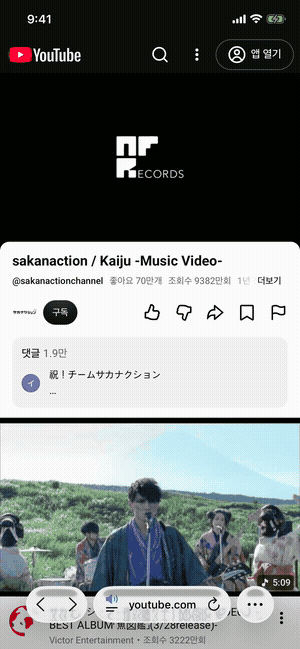
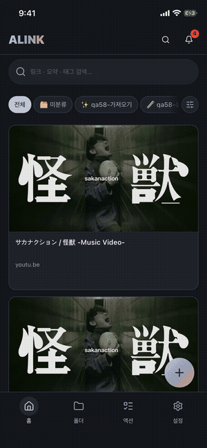

# ALink · 에이링크

**AI가 도와주는 북마크 아카이브 서비스**

흩어진 링크를 간편하게 저장하고, AI의 도움으로 요약하고 정리하세요.
키워드로 북마크를 다시 찾고, 저장한 정보를 액션으로 이어갈 수 있습니다.

[웹 바로가기](https://archivelink.app) · [App Store](https://apps.apple.com/kr/app/%EC%97%90%EC%9D%B4%EB%A7%81%ED%81%AC-alink-ai%EA%B0%80-%EB%8F%84%EC%99%80%EC%A3%BC%EB%8A%94-%EB%B6%81%EB%A7%88%ED%81%AC-%EC%95%84%EC%B9%B4%EC%9D%B4%EB%B8%8C/id6788230955) · [사용 가이드](https://warp-raft-63c.notion.site/ALink-Tips-412d602d12548000ab51c9da56783374)

## 소개 영상

[ALink Tips](https://warp-raft-63c.notion.site/ALink-Tips-412d602d12548000ab51c9da56783374)의 실제 사용 영상입니다. 미리보기를 클릭하면 가이드의 원본 영상으로 이동합니다.

|                                                                                                          빠른 아카이브                                                                                                          |                                                                                                         간편한 검색                                                                                                          |
| :-----------------------------------------------------------------------------------------------------------------------------------------------------------------------------------------------------------------------------: | :--------------------------------------------------------------------------------------------------------------------------------------------------------------------------------------------------------------------------: |
|  |  |
|                                                                                         유튜브, 인스타그램, 브라우저에서 간편하게 저장                                                                                          |                                                                                             제목을 몰라도 생각나는 키워드로 검색                                                                                             |

## Channel

ALink의 모바일·웹 클라이언트 레포지토리입니다.

## Tech Stack

| 분야                     | 기술                                                                                                                                                                                                                                                                                       | 용도                                      |
| ------------------------ | ------------------------------------------------------------------------------------------------------------------------------------------------------------------------------------------------------------------------------------------------------------------------------------------ | ----------------------------------------- |
| Language                 |                                                                                                                                                                                    | 타입 기반 개발                            |
| Framework                |    | 모바일과 웹을 위한 공통 앱                |
| Routing                  |                                                                                                                                                                                      | 파일 기반 라우팅                          |
| State Management         |                                                                                                                                                                                                                          | 클라이언트 전역 상태                      |
| Server State             |                                                                                                                                                                          | 서버 데이터 조회, 캐시, 동기화            |
| Styling                  |                                                                                                     | 유틸리티 클래스와 공통 디자인 토큰        |
| Forms & Validation       |                                                                                | 폼 상태 관리와 스키마 검증                |
| HTTP Client              |                                                                                                                                                                                                   | API 통신                                  |
| Animation                |                                                                                                                                                                                                                    | 네이티브 애니메이션                       |
| Analytics                |                                                                                                                                                                    | 사용자 이벤트 분석                        |
| Testing & UI Development |                         | 단위 테스트, 웹 E2E 테스트, 컴포넌트 개발 |
| Tooling                  |           | 패키지 관리와 코드 품질                   |
